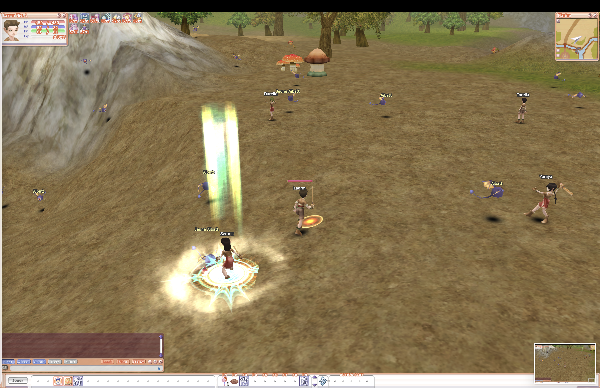
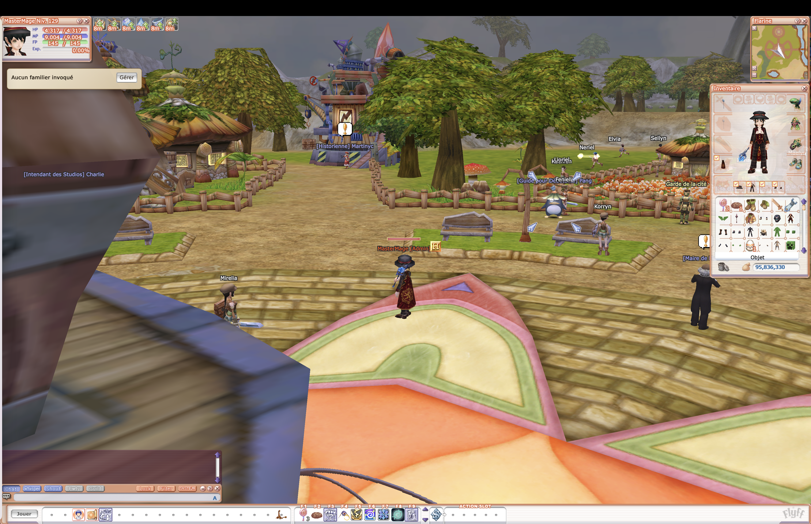

# FlyffRewriteRust

A **Rust** rewrite of Flyff V15, with a game server, an HTTP server, and a playable browser client. The client uses **TypeScript, React, three.js, and WebAssembly**; shared game rules and simulation are implemented in Rust.

The project targets a Linux distribution built around a single `flyff` executable with an embedded web client. **Original assets are not included. You must obtain a V15 version of Flyff separately and provide its `Resource/` directory.**

**Work in progress.** This repository contains an extensive implementation, but it is not a final release and does not guarantee full parity with the original game.

## Gameplay preview

Screenshots of the project with V15 assets loaded.

**Flarine: characters, monsters, and skill effects.**



**Flarine: environment, NPCs, and character inventory.**



## Progress and remaining work

Status based on the source code as of **November 9, 2026**. A checked item under “Implemented” means the system's code is present; it does not guarantee complete in-game validation or full parity with Flyff V15. This checklist summarizes the repository's current state and does not replace the historical design documents.

### Implemented in the source code

- [x] Rust server, HTTP, sessions, and WebSocket / Protocol Buffers transport.
- [x] Accounts, login, character creation, and character selection.
- [x] V15 asset loading and conversion, 3D web client, and game interface.
- [x] Shared Rust / WASM simulation: ground movement, flight, collisions, and game rules.
- [x] Monsters, AI, combat, skills, buffs, and stats.
- [x] Inventory, equipment, trading, shops, banking, mail, and item upgrades.
- [x] Chat, parties, messenger, guilds, couples, and mentoring.
- [x] Lua 5.3 dialogue, NPC scripts, and a quest engine with objectives and rewards.
- [x] Systems for pets, housing, instances, sieges, Lord, taxes, Secret Room, Rainbow Race, and quizzes.
- [x] SQLite persistence, migrations, and backup tools.
- [x] Administration console, player management, and audit log, subject to the limitations below.
- [x] Tools for development, code generation, web builds, and Linux distribution packaging.

### Features to complete or decide on

- [ ] Implement the `replay` command, the CLI `grant` command, and the remaining unavailable exports; the `gamedata-json` export already exists.
- [ ] Enable maintenance mode control through the administration interface.
- [ ] Complete the nine content administration panels: events, Lord, taxes, Secret Room, sieges, Rainbow Race, quizzes, instances, and housing. Their routes still return “feature unavailable,” even when the corresponding game system exists.
- [ ] Address the 15 GM commands marked as deferred, including weather, music/sounds, player lists, and maintenance, or document their permanent exclusion.
- [ ] Complete the currently deferred guild/party boss quest helpers, including Wormon.
- [ ] Review and complete quest content using the separately supplied V15 assets. The repository's small synthetic quest set is not a complete V15 campaign.
- [ ] Implement native TLS if that option is retained; HTTPS currently requires TLS termination through a reverse proxy.
- [ ] Clarify the scope of reserved options, including the second password, and unsupported WebSocket compression.
- [ ] Update references to old tests and missing documents, and review the retained synthetic content to keep only additions useful to the game.

These items can be checked in the [CLI](crates/flyff-server/src/cli.rs), [grant command wiring](crates/flyff-server/src/wiring.rs), [maintenance mode](crates/flyff-server/src/admin/api/server/maintenance.rs), [content panels](crates/flyff-server/src/admin/api/content.rs), [GM command catalog](crates/flyff-game/src/gm/table.rs), and [Wormon quests](crates/flyff-game/src/quest/wormon.rs).

### Validation before a stable release

These items remain unchecked until a complete, reproducible acceptance process has been documented.

- [ ] Build and verify the entire pipeline: WASM module, web bundle, and Linux distribution with the embedded client.
- [ ] Verify a fresh installation using an external V15 `Resource/` directory and a generic configuration.
- [ ] Validate complete gameplay flows: character creation, combat, progression, inventory, trading, quests, and reconnection.
- [ ] Verify backups, restores, and migrations with representative data.
- [ ] Assess long-running stability, multiplayer performance, and browser compatibility.
- [ ] Compare behavior and rendering with the V15 game to identify and fix discrepancies.

Checks already performed while preparing the repository cover Rust compilation checks, formatting, TypeScript, and targeted linting. The TypeScript check used WASM API declarations without rebuilding the module, so it does not complete validation of the entire pipeline.

### Public repository preparation

- [x] Publish the sources on GitHub with installation and build instructions in the README.
- [x] Exclude original assets and explain that V15 resources must be supplied separately.
- [x] Remove test suites, private configurations, and operational data from the published files.
- [x] Add gameplay screenshots to the README.

Original assets, public test suites, and private configurations are intentionally outside the scope of this distribution. The remaining validation work does not require adding them to the repository.

## Prerequisites

| Component | Version / purpose |
| --- | --- |
| Rust via rustup | **1.99.0**, pinned in `rust-toolchain.toml` |
| Node.js | **24.x**; `.node-version` specifies the reference version |
| pnpm | **12.11.2**, pinned in `web/package.json` |
| Flyff V15 assets | A separately supplied V15 version with its `Resource/` directory |
| C compiler and build tools | SQLite, Lua, and some native dependencies |
| Rust target `wasm32-unknown-unknown` | Client WebAssembly module |
| Code generation tools | Versions pinned in `xtask/src/tools.rs`; verified by `cargo xtask tools check` |
| Linux x86-64 + `musl-gcc` | Building the static Linux distribution |

The distribution pipeline targets Linux x86-64. To build this package from macOS or Windows, use a suitable Linux environment.

## Installation and startup

```bash
git clone https://github.com/Laarm/FlyffRewriteRust.git
cd FlyffRewriteRust

# Install the toolchain and components pinned by the repository.
rustup show

# With Corepack installed: enable the pnpm version specified in package.json.
corepack enable
pnpm --dir web install --frozen-lockfile

# Install auxiliary tools, then check the environment.
cargo xtask tools install
cargo xtask doctor
```

Some system dependencies must be installed separately. On Debian/Ubuntu, `cargo xtask tools install --apt` can install the system packages supported by the tool.

### Game assets

**Obtain a V15 version of Flyff**: the original `Resource/` directory is required to start a world. This repository does not provide the original client, a V15 archive, or original assets. Assets from other versions are not guaranteed to be compatible.

Keep your `Resource/` directory outside the repository and configure its location before starting the server:

```bash
export FLYFF_RESOURCE="/path/to/Flyff V15/Resource"
```

`FLYFF_SOURCE` is optional for playing: it points to the legacy C++ sources and is used by some generators. Generated sources required for compilation are already included.

```bash
# Optional: only needed by tools that require it.
export FLYFF_SOURCE="/path/to/Flyff V15/Source"
```

### Development server and client

```bash
cargo xtask dev --resource "$FLYFF_RESOURCE"
```

This command prepares the WASM module, starts the server at `127.0.0.1:8080`, starts the Vite client at **http://localhost:5173/**, and enables WASM module rebuilds. Local state is stored in `.dev/`.

To start only the server:

```bash
cargo run --locked -p flyff-server -- serve \
  --home .dev \
  --resource "$FLYFF_RESOURCE" \
  --bind 127.0.0.1:8080
```

Starting the server alone does not build the web client. To serve an existing client build, add `--web-dir web/dist`.

### Configuration and administration

The server uses `flyff.toml` in its runtime directory. An annotated template is available at [`crates/flyff-server/assets/flyff.toml.example`](crates/flyff-server/assets/flyff.toml.example).

```bash
cargo run --locked -p flyff-server -- --help
cargo run --locked -p flyff-server -- config default
```

Environment variables named `FLYFF__SECTION__KEY` can override settings, for example `FLYFF__NET__BIND=127.0.0.1:8080`. The administration console is available at `/admin` when the web client is served; access depends on server configuration and authentication.

Keep deployment configurations, accounts, backups, administration tokens, and certificates outside the repository. The `.gitignore` covers common locations.

## Building

```bash
# Native server
cargo build --locked --release -p flyff-server

# Web client: WASM, TypeScript checks, and Vite bundle
cargo xtask build-web

# Linux x86-64 package with embedded client, built in a suitable Linux environment
cargo xtask dist --out dist/flyff
```

The package contains the executable, NPC scripts, a sample configuration, and dependency notices. Supply the `Resource/` directory to the server separately. Build outputs in `target/`, `web/dist/`, and `dist/` are excluded from Git.

## Verification

```bash
cargo fmt --all -- --check
cargo check --workspace --locked

# Build the WASM module before running web checks.
cargo xtask build-wasm --dev
pnpm --dir web typecheck
pnpm --dir web lint
```

This distribution contains only the game sources and the tools needed to build them and generate data. Test suites, fixtures, demo pages, internal tracking tools, and private configurations are excluded. Some code comments still reference historical design documents that are not included.

## Repository layout

| Directory | Contents |
| --- | --- |
| `crates/flyff-server` | Executable, HTTP/WebSocket, configuration, administration |
| `crates/flyff-game` | World, entities, and gameplay systems |
| `crates/flyff-sim`, `crates/flyff-rules` | Shared simulation and rules |
| `crates/flyff-db` | SQLite, migrations, and persistence |
| `crates/flyff-lua` | Lua script execution |
| `crates/flyff-assets`, `crates/flyff-data`, `crates/flyff-formats`, `crates/flyff-vfs`, `crates/flyff-script` | Game data loading and conversion |
| `crates/flyff-common`, `crates/flyff-proto`, `crates/flyff-wasm` | Shared types, protocol, and WASM interface |
| `web/` | Browser client, interface, and administration |
| `content/` | NPC scripts, supplemental quests, and sample quiz |
| `proto/`, `schemas/` | Network protocol and data schemas |
| `xtask/`, `tools/` | Building, generation, and verification |

Generated protocol, constant, and schema files are retained because they are required for compilation. Generic build configurations and the server configuration template are included; no private deployment configuration is provided.

## Contributing

Open an issue or pull request on [Laarm/FlyffRewriteRust](https://github.com/Laarm/FlyffRewriteRust). Describe the behavior involved, reproduction steps, and checks performed. Keep dependency lockfiles.

Do not attach player databases, logs containing personal data, deployment secrets, or archives of original assets.

## License

The repository uses the **Apache 2.0** license already established on GitHub: see [LICENSE](LICENSE). Third-party components retain their own licenses, including the [DejaVu font](web/src/static/fonts/LICENSE-DejaVu.txt).

Flyff and its original assets belong to their respective rights holders. This is an independent project; the repository's license grants no rights to the original assets supplied separately.
